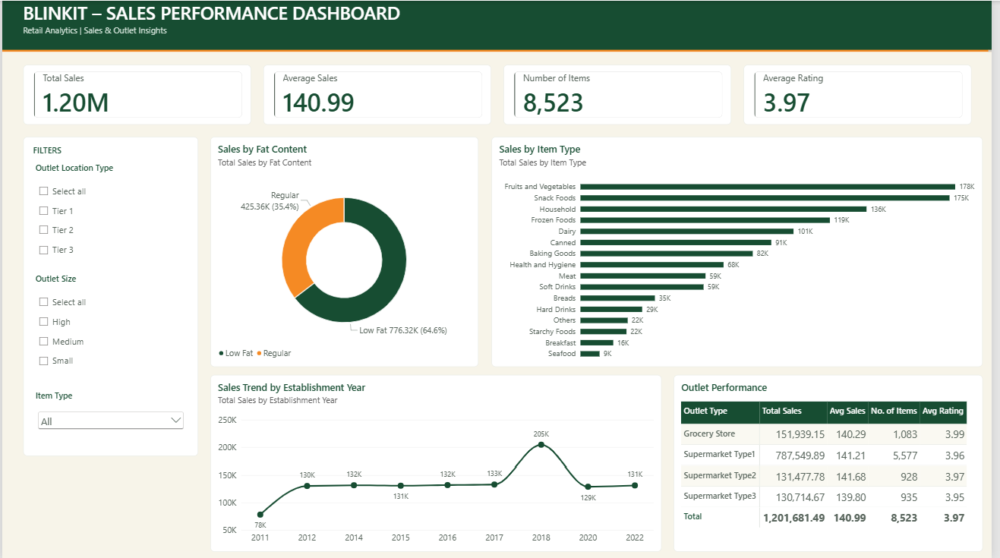

# Blinkit Sales & Outlet Performance Analysis

## Project Overview

An end-to-end retail data analytics project analyzing **1.20M in total sales value** across **8,523 product-outlet records** using **Excel**, **SQL Server (T-SQL)**, and **Power BI**.



## Key Business Insights

- **Overall Performance:** Analyzed **1.20M** in total sales value across **8,523 product-outlet records**, with an average sales value of **140.99 per record** and an average customer rating of **3.97/5.0**.
- **Top Product Categories:** **Fruits & Vegetables (178.1K)** and **Snack Foods (175.4K)** recorded the highest sales among the 16 product categories.
- **Fat Content Analysis:** **Low Fat** products contributed **64.6% (776.3K)** of total sales value, compared with **35.4% (425.4K)** from Regular products.
- **Outlet Performance:** **Supermarket Type 1** accounted for **65.5% (787.5K)** of total sales value across 5,577 records. Outlets established in **2018** recorded the highest cumulative sales (**204.5K**) among the establishment-year groups.

## Tools & Workflow

- **Excel:** Standardized inconsistent categorical labels, retained records with missing weight values, and performed duplicate-record checks.
- **SQL Server (T-SQL):** Developed analytical queries using `GROUP BY`, `CASE WHEN`, and window functions to examine sales trends and key performance indicators.
- **Power BI:** Created an interactive dashboard featuring DAX measures (`Total_Sales`, `Avg_Sales`, `No_of_Items`, `Avg_Rating`), interactive slicers, and outlet performance visualizations.

## Repository Structure

```text
Blinkit-Sales-Analysis/
│
├── blinkit_cleaned.csv
├── blinkit_analysis.sql
├── blinkit_sales_dashboard.pbix
├── dashboard_preview.png
└── README.md
```

| File | Description |
|---|---|
| `blinkit_cleaned.csv` | Cleaned retail dataset containing 8,523 product-outlet records |
| `blinkit_analysis.sql` | SQL queries for exploratory analysis and KPI evaluation |
| `blinkit_sales_dashboard.pbix` | Interactive Power BI report |
| `dashboard_preview.png` | Visual preview of the Power BI dashboard |

## Project Objective

To transform retail sales data into meaningful business insights through data cleaning, SQL-based analysis, and interactive visualization, enabling a better understanding of product and outlet performance.
